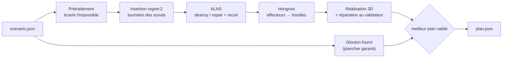

# Fleet Orchestration : planner ALNS et policy link-loss

Projet réalisé pendant le hackathon **EDTH Paris** (20 au 22 novembre 2026), sur le sujet *Fleet Orchestration* d'Alta Ares.


Une flotte mixte de **scouts** et d'**effecteurs** part de ses bases. Au sol, il y a des contacts (hostiles, inconnus, amis, civils) et des zones interdites. Il y a plus de contacts que la flotte ne peut en servir.

Un scout doit observer un contact avant qu'un effecteur puisse le frapper. Chaque effecteur ne sert qu'une fois. Dix règles écrites s'appliquent, et un plan qui en viole une seule vaut 0.

Le projet a deux livrables :

1. **Un planner** (`handin/planner.py`). Il lit un `scenario.json` et écrit un `plan.json` : qui va où, quand, dans quel ordre.
2. **Une policy link-loss** (`handin/policy.py`). Elle prend le relais quand la liaison sol est coupée en vol. Chaque appareil décide seul, une fois par seconde, avec ce qu'il voit et ce que les autres lui disent.

📖 **Le pourquoi de chaque choix, avec schémas et captures du viewer : [docs/planner-alns-les-choix.md](fleet-orchestration/docs/planner-alns-les-choix.md)**

## Résultats

### Planner : les 8 scénarios de validation

| Scénario | Glouton fourni | Notre planner | Gain |
|---|---:|---:|---:|
| L1-101 | 68,0 | 70,8 | +4 % |
| L2-201 | 277,8 | 294,9 | +6 % |
| L2-202 | 232,9 | 266,7 | +15 % |
| L3-301 | 423,8 | 721,5 | +70 % |
| L3-302 | 326,5 | 416,1 | +27 % |
| L3-303 | 275,9 | 444,9 | +61 % |
| L4-401 | 641,2 | 1 673,4 | ×2,6 |
| L4-402 | 418,5 | 1 186,5 | ×2,8 |
| **Total** | **2 664,5** | **5 074,7** | **×1,90** |

Les 8 plans sont valides, avec au plus 43 s par scénario. Le score vaut points − 0,5 × Wh − 10 × effecteurs consommés.

### Link loss

Mesures faites avec `check_policy.py` sur les niveaux L2, L3 et L4, graines 0 et 1 :

- **Rétention de 100 %** sur tous les cas, avec **0 run en échec**.
- **S_loss** entre **0,987 et 0,997**.
- **1,7 à 6,4 messages** par appareil par minute, contre 60 pour la baseline `broadcast`, qui échoue sur 5 des 6 cas.
- **Grille de sizing : 20 cases sur 20.** La frontière est à 50 o/s pour toutes les portées.
- **0,02 à 0,1 ms par appel**, pour une limite de 50 ms sur Raspberry Pi 5.

## Démarrage rapide

Il suffit de Python ≥ 3.10. Il n'y a aucune dépendance : tout tient dans la bibliothèque standard.

```sh
git clone <ce dépôt>
cd fleet-orchestration/fleet-kit

# 1. Générer un scénario (niveaux L1 à L4) et lancer le planner
python3 -m fleetkit generate L3 7 -o scenario.json
python3 handin/planner.py scenario.json plan.json          # ~45 s, écrit toujours un plan valide

# 2. Vérifier, scorer, visualiser
python3 -m fleetkit validate scenario.json plan.json
python3 -m fleetkit score scenario.json plan.json
python3 -m fleetkit view scenario.json plan.json --open    # le plan en vol dans le navigateur

# 3. Comparer au glouton fourni
python3 -m fleetkit baseline scenario.json -o greedy.json
python3 -m fleetkit score scenario.json greedy.json
```

### Les 8 scénarios de validation

```sh
python3 -m fleetkit validation-set -o validation
mkdir -p my-plans
for f in validation/*.json; do
  python3 handin/planner.py "$f" "my-plans/$(basename "$f")"
  python3 -m fleetkit score "$f" "my-plans/$(basename "$f")"
done
```

### Link loss

```sh
python3 -m fleetkit events scenario.json plan.json --seed 1 -o events.json   # coupure + 2 à 3 événements
python3 -m fleetkit linkloss scenario.json plan.json events.json handin/policy.py
python3 -m fleetkit linkloss scenario.json plan.json events.json handin/policy.py --sizing   # grille complète
python3 -m fleetkit linkloss scenario.json plan.json events.json broadcast                   # baseline, pour comparer
python3 -m fleetkit view scenario.json plan.json --events events.json --policy handin/policy.py -o run.html --open
```

### Vérifier le rendu comme le jury

```sh
python3 handin/check_handin.py                          # planner, L1 à L4, graines 0-1
python3 handin/check_policy.py --levels L2,L3,L4        # policy link-loss
python3 handin/tests/regression.py                      # doit afficher ALL IDENTICAL (12 cas, ~5 s)
python3 handin/bench.py --levels L3,L4 --seeds 100-104  # benchmark multi-graines contre le glouton
```

### Réglages (variables d'environnement)

| Variable | Défaut | Rôle |
|---|---|---|
| `FLEET_BUDGET` | `45` | temps de calcul visé par scénario (s) |
| `FLEET_HARD_LIMIT` | `55` | limite dure ; l'évaluation coupe à 60 s |
| `FLEET_KNAPSACK` | off | choix exact des hostiles quand les effecteurs manquent |
| `FLEET_WEAK_ROUTE` | off | opérateur destroy supplémentaire (consolidation des tournées) |
| `FLEET_VERIFY` | off | optimise pour le board optionnel *verify* |
| `FLEET_SEED` | `0` | diversifie les runs hors ligne |
| `FLEET_DETERMINISTIC` | off | horloge virtuelle : même plan bit pour bit (tests) |

## Comment ça marche

### Le planner, en 6 étapes



1. **Baseline d'abord.** Le glouton fourni tourne en premier. On ne fait jamais moins bien que lui, et le planner ne plante jamais.
2. **Prétraitement.** On retire les contacts impossibles : collatéral R7, fenêtre plus courte que le dwell de 20 s, aucun point d'observation libre, aucun effecteur à portée.
3. **Découpage.** La recherche ne porte que sur les tournées des scouts, un TOPTW. Les effecteurs sont une affectation, résolue exactement par l'algorithme hongrois.
4. **ALNS.** On a 5 opérateurs destroy et 3 repair (insertion regret-2). Leurs poids s'adaptent par roulette, et l'acceptation se fait par recuit simulé.
5. **Réalisation 3D.** Les 5 meilleures solutions deviennent des waypoints datés : altitudes, séparation de 40 m, synchronisation des groupes.
6. **Validation.** Chaque plan est réparé avec le validateur officiel, et on garde le meilleur vrai score.

### La policy link-loss

- **Navigation à l'estime.** Chaque appareil connaît le plan complet. Un pair silencieux est supposé suivre sa route, donc seul celui qui dévie parle.
- **Deux messages sur événement**, de 64 octets au plus :
  - `{"k":[tau,rate]}` dit « je quitte le plan » ;
  - `{"o":["C12"]}` dit « l'observation de C12 est finie ».
- **Porte R4.** Un effecteur ne frappe que s'il a la preuve que sa cible a été observée. Sinon, il attend un pas avant elle.
- **Abandon propre.** Si la cible est reclassée, si une zone apparaît sur la route ou si la fenêtre est ratée, l'appareil revient à sa base par sa route.
- **Bouclier anticollision.** Chaque action candidate (continuer, ralentir, attendre, reculer) est simulée sur 4 à 6 s, et la policy joue la première qui est sûre.
- **Filet de sécurité.** Toute exception renvoie `hold`.

Le détail de chaque choix, avec ses raisons et ses avantages, est dans [docs/planner-alns-les-choix.md](fleet-orchestration/docs/planner-alns-les-choix.md).

## Organisation du code

```
fleet-orchestration/
├── README.md                  énoncé du sujet (Alta Ares)
├── docs/                      explication détaillée + images
└── fleet-kit/
    ├── fleetkit/              kit officiel : générateur, validateur, score, viewer, link-loss
    └── handin/                ← notre rendu
        ├── planner.py         point d'entrée du planner
        ├── policy.py          policy link-loss
        ├── fleetplan/
        │   ├── config.py      tous les réglages (Settings, FLEET_*)
        │   ├── world.py       modèle du problème : candidats, anneaux d'observation
        │   ├── search/        ALNS : insertion, destroy, recuit, recherche locale
        │   ├── algorithms/    algorithme hongrois
        │   ├── geometry/      obstacles, séparation R8
        │   ├── flight/        waypoints 3D des scouts et effecteurs
        │   └── pipeline/      solver, réparation, élagage, vérification
        ├── tests/             test de non-régression (déterministe)
        ├── check_handin.py    lance le rendu comme l'évaluation
        ├── check_policy.py    teste la policy link-loss
        └── bench.py           benchmark multi-graines
```

Le détail technique du code (dépendances entre modules, tests) est dans [`fleet-kit/handin/README.md`](fleet-orchestration/fleet-kit/handin/README.md). L'énoncé complet et les dix règles sont dans [`fleet-orchestration/README.md`](fleet-orchestration/README.md) et [`fleet-kit/README.md`](fleet-orchestration/fleet-kit/README.md).
