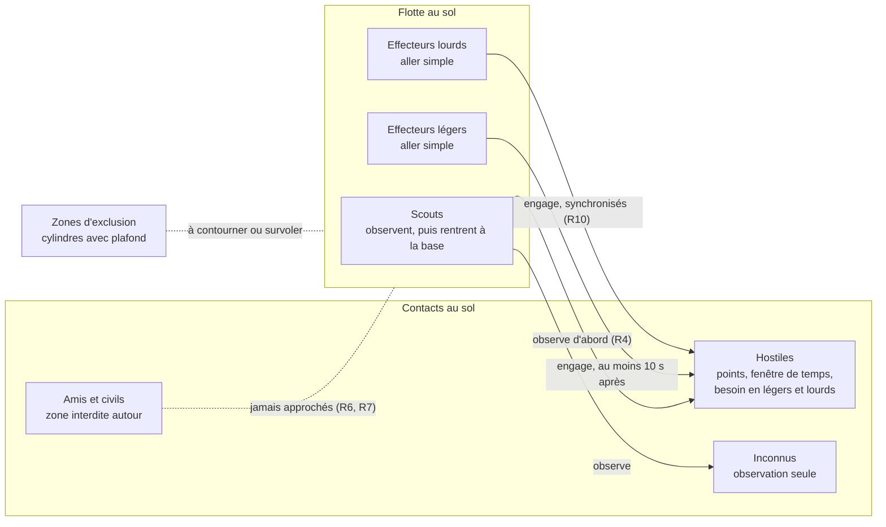
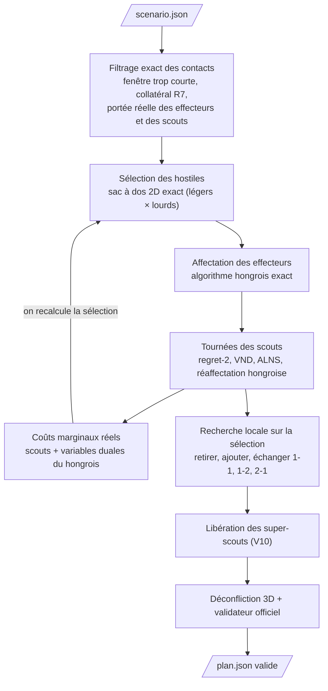
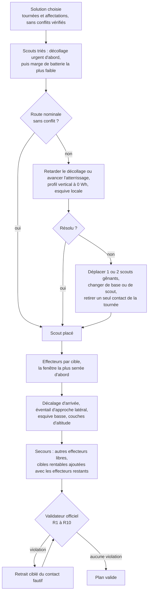
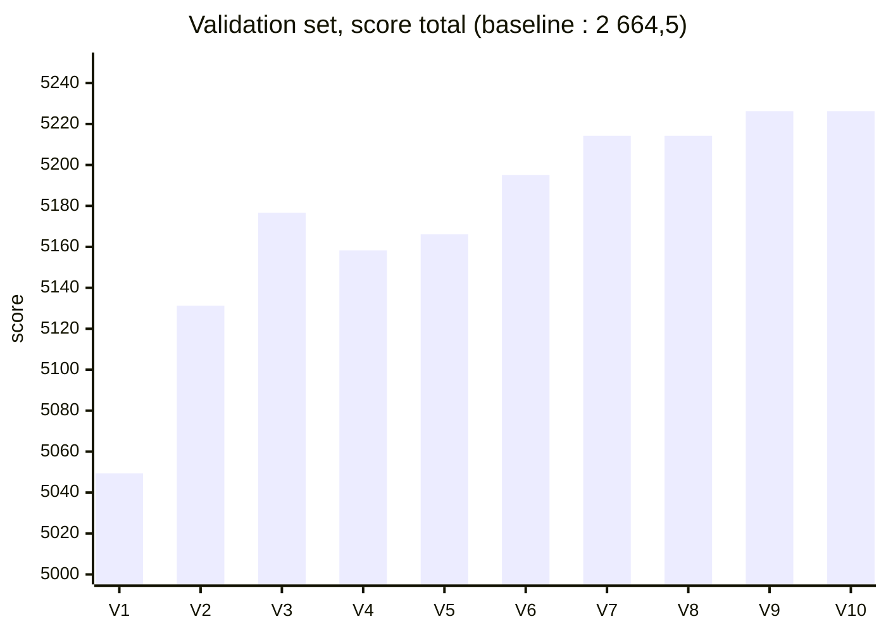
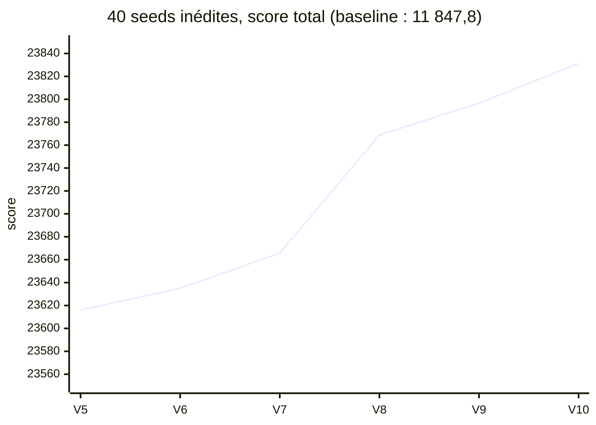
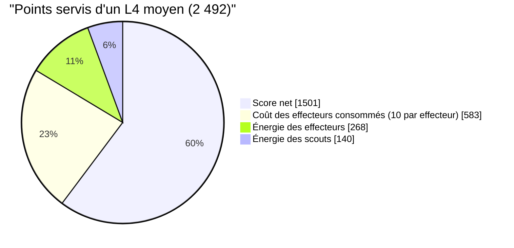
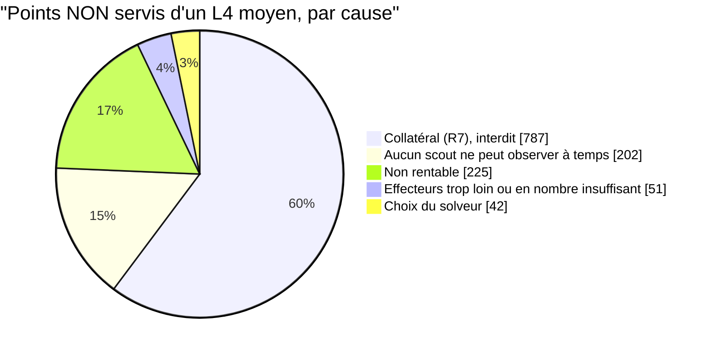
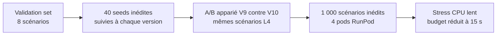

# Fleet Orchestration — la solution finale (V10)

V10 (commit `3fdbd2e`) produit des plans **toujours valides** et vaut **environ 2× le baseline glouton** au total, et **2,9× sur les grands scénarios L4**, qui pèsent le plus dans le classement.

| | Validation set (8) | 40 seeds 0-9 | 1 000 scénarios inédits |
|---|---|---|---|
| Plans valides | 8/8 | 40/40 | 1 000/1 000 |
| Score | 5 226,3 | 23 831,2 | 605 320,6 |
| Ratio sur le baseline | 1,96× | 2,01× | 1,95× (L4 : 2,86×) |
| Temps max (limite 60 s) | 27,5 s | 45,0 s | 44,4 s |

Les deux premières colonnes ont été remesurées indépendamment avec `bench/bench.py` (outil de bench parallèle, pas encore committé). La troisième vient de la campagne RunPod décrite dans `RESEARCH_LOG.md`.

---

## 1. Le problème



**Score = points des contacts servis − 0,5 × énergie (Wh) − 10 × effecteurs consommés.** Un plan qui viole une seule des dix règles vaut **0**.

Le problème mêle trois difficultés, chacune déjà difficile seule :
- **choisir quoi servir** : un sac à dos à deux capacités, les effecteurs légers et les lourds ;
- **organiser les tournées des scouts** : un problème de tournées avec fenêtres de temps (VRPTW) ;
- **faire voler tout le monde sans conflit** : des trajectoires 3D minutées qui respectent les 40 m de séparation.

## 2. L'idée centrale : une décomposition couplée

Plutôt qu'un seul gros solveur, on résout séparément chaque sous-problème avec la meilleure méthode connue pour lui. On les relie ensuite par les **coûts marginaux** : combien coûte réellement l'ajout d'une cible.



Ce que chaque brique apporte :

| Brique | Méthode | Pourquoi |
|---|---|---|
| Sélection | Sac à dos 2D exact par programmation dynamique | Les capacités en légers et lourds sont les vraies contraintes dures. |
| Effecteurs | Algorithme hongrois, avec ses variables duales | Affectation **optimale** pour une sélection donnée. Les variables duales donnent le vrai coût d'opportunité de chaque effecteur. |
| Scouts | Insertion regret-2, VND (2-opt, Or-opt, relocate, swap) et ALNS | Les disques d'observation (147 m de rayon à 30 m d'altitude) se chevauchent, et une seule tournée peut observer plusieurs contacts presque sans voler. |
| Trajectoires | Plus court chemin autour des cylindres, profil de vitesse convexe | La puissance croît avec v², donc il existe une vitesse optimale. Ralentir pour profiter du temps disponible coûte moins cher que voler vite puis attendre. |

## 3. Le pipeline et son budget de temps

Le planner a **45 s de budget**, pour une limite officielle de 60 s. Chaque étape est bornée par une fraction de ce budget. Les étapes ont aussi un nombre d'itérations fixe, si bien que la plupart des L4 s'arrêtent bien avant : médiane d'environ 19 s sur 250 L4.

```mermaid
gantt
    title Bornes de temps d'un L4 (secondes)
    dateFormat X
    axisFormat %S
    section Recherche
    Stages 1 à 4 et 4b, sélection, VRPTW, ALNS     :s1, 0, 32
    section Plan valide
    Stage 5, déconfliction des meilleurs candidats :s5, 32, 35
    Stage 6, relances perturbées                   :s6, 35, 40
    Stage 7, trio de secours                       :s7, 40, 43
    section Marges
    Fin du budget du planner                       :m1, 43, 45
    Marge sous la limite officielle                :crit, m2, 45, 60
```



| Étape | Rôle |
|---|---|
| 1. Graines | Sac à dos exact avec plusieurs hypothèses de coût des scouts. Pour les petits scénarios, les meilleurs sous-ensembles sont énumérés. |
| 2. Tarification | On injecte les coûts marginaux réels de la meilleure solution, puis on relance le sac à dos (avec jitter). |
| 3. Échanges | Retraits, ajouts et échanges d'hostiles, démarrés à partir de la solution courante. |
| 4. Polissage | ALNS et VND profonds sur les tournées de la meilleure solution. |
| 4b. Super-scouts (V10) | Les scouts à longue portée étaient remplis de cibles proches que n'importe quel scout aurait pu faire. On les libère pour les cibles lointaines que seuls 1 à 3 scouts atteignent. |
| 5. Plan valide | Déconfliction des meilleures solutions distinctes. Une solution qui ne peut pas battre la meilleure est sautée. |
| 6. Relances | Sélections perturbées si du temps reste (scénarios avec plus de 8 hostiles). |
| 7. Secours (V10) | Si la déconfliction a coûté plus de 3,5 points, trois stratégies de placement de rechange. On garde la meilleure. |

## 4. De la solution au plan valide : la déconfliction

C'est la partie qui garantit qu'aucun plan ne vaut 0. Toutes les vérifications de séparation passent par un index spatial (boîtes englobantes) qui calcule exactement R8 au fur et à mesure.



La boucle finale s'appuie sur le validateur officiel du kit. Dans le pire des cas, on perd un contact, jamais le scénario entier.

## 5. Résultats

### Progression sur le validation set (8 scénarios publics)



Les gains se concentrent sur les deux L4. Les six scénarios L1 à L3 sont au même score depuis V5 : d'après l'audit de V10, on y est déjà à environ 99,5 % de ce qui est réalisable.

### Sur des seeds inédites (40 scénarios, seeds 0-9)



### Où vont les points d'un L4

Il s'agit de la moyenne sur 4 L4 (L4-401, L4-402, L4-0 et L4-1), mesurée sur V10 avec `fleet-orchestration/diag/diag_unserved.py` (branche `c6`).





Ce qu'il faut en retenir :
- **L'essentiel des points non servis est hors d'atteinte.** Le collatéral est interdit par les règles. Pour les contacts « hors portée », on a vérifié à la main qu'ils sont **physiquement impossibles** : aucun scout ne peut finir son observation avant la fin de la fenêtre moins la marge de confirmation.
- **Le « choix du solveur » ne pèse que 42 points bruts.** Un test qui ajoute chacun de ces contacts à la solution finale et mesure le score réel (`diag/probe_insert.py`, branche `c6`, lancé sur V6) n'a trouvé **aucun ajout rentable** sur les L4 testés.
- **Le surcoût d'énergie évitable est d'environ 2,4 points par L4**, d'après l'audit de V10. Le reste de l'énergie est incompressible : distances et altitude minimales.

## 6. Comment on sait que c'est fiable



| Vérification | Annoncé dans le journal | Remesuré indépendamment |
|---|---|---|
| Validation set V10 | 5 226,31, 8/8 | **5 226,3, 8/8** |
| A/B V9 → V10 sur des L4 inédits | +37,3 sur 30 L4, 8 gagnés / 22 égaux / 0 perdu | **+40,3 sur 20 L4 (seeds 1000-1019), 6 gagnés / 14 égaux / 0 perdu** |
| 40 seeds 0-9 | non publié pour V10 | **23 831,2, 40/40, 2,01×** |
| Temps max | 44,4 s (1 000 scénarios) | **45,0 s** (40 seeds, 6 runs en parallèle) |
| 1 000 scénarios RunPod | 1 000/1 000 valides | non remesuré (300 scénarios sur V7 : 300/300) |

## 7. Limites et risques

- **Le temps sur une machine plus lente.** L'initialisation (graphe de visibilité, pré-calcul des effecteurs) et la réparation finale peuvent déborder le budget de 45 s. Sur V7, avec un CPU environ 4× plus lent, on a mesuré 51 s au maximum. La marge reste là, mais elle n'est pas infinie.
- **Le bruit de mesure.** Le planner s'arrête sur une horloge. Un gain de quelques points sur un seul L4 n'est pas significatif ; seules les comparaisons appariées sur plusieurs dizaines de scénarios le sont.
- **La complexité.** `solver.py` fait environ 2 600 lignes. Chaque ajout depuis V6 a été validé par une comparaison sans régression, mais l'ensemble est devenu difficile à relire.
- **La marge restante est faible.** Le choix des cibles est saturé et l'énergie quasi incompressible. Les gains restants se jouent surtout dans la déconfliction des L4 les plus denses.

## Pour reproduire

```sh
cd fleet-orchestration/fleet-kit
python3 handin/check_handin.py --levels L1,L2,L3,L4 --seeds 0-4      # harnais officiel
cd ../bench && python3 bench.py run HEAD --suite val                 # validation set, en parallèle
python3 bench.py compare e603705 HEAD --suite l4                     # A/B V9 contre V10
```
