# Planner ALNS, les choix

*fleet-kit · handin/fleetplan · exemple L3-301*

Chaque étape, pourquoi on l'a faite comme ça, et ce qu'elle rapporte.

- [Partie 1 : le planner](#partie-1--le-planner) (étapes 00 à 09, scénario L3-301)
- [Partie 2 : link loss](#partie-2--link-loss-quand-le-sol-se-tait) (étapes 10 à 17, la policy embarquée quand la liaison sol est coupée)

Toutes les captures viennent du viewer du kit.

> 🌐 Version page web, plus visuelle : [planner-alns-les-choix.html](planner-alns-les-choix.html) (à ouvrir dans un navigateur).

---

## Partie 1 : le planner

### 00 · Le problème

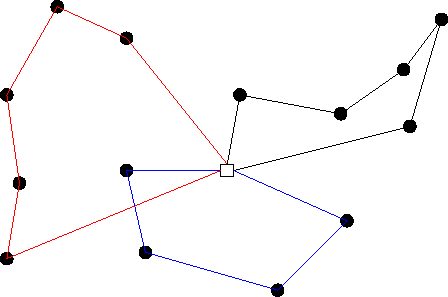

Pour nous :

- le dépôt est la base ;
- les véhicules sont les scouts ;
- les clients sont les contacts.

Chaque contact a une **fenêtre de temps** et rapporte des points, et on n'est pas obligé de tous les servir. C'est un **TOPTW** (tournées d'orientation avec fenêtres de temps). Il s'y ajoute l'affectation des effecteurs aux hostiles.

Le problème est NP-difficile : on cherche une très bonne solution en 45 s, pas l'optimum prouvé.

*Image : un dépôt, des véhicules, des clients à visiter. C'est le problème de tournées classique (VRP).*

<br clear="right">

### 01 · Baseline d'abord, ALNS ensuite

`planner.py` calcule le plan glouton fourni, puis lance l'ALNS avec le temps restant. Il écrit le meilleur plan **valide**.

> **Pourquoi :** un plan invalide vaut 0, et un crash aussi.
>
> **Avantage :** on a un plancher garanti. On ne fait jamais moins que la baseline, même si l'ALNS plante ou manque de temps.

### 02 · Prétraitement : écarter l'impossible

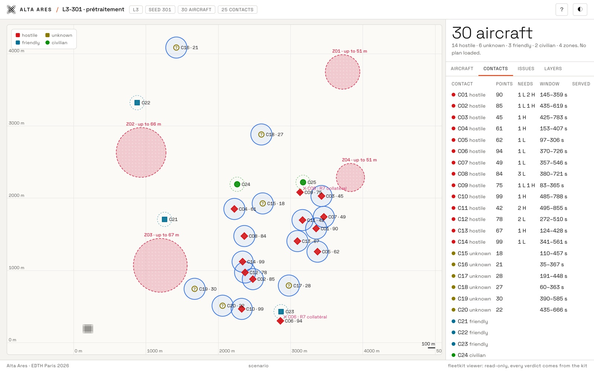

*Les cercles bleus sont les anneaux d'observation (146,5 m) des 18 contacts gardés. En rose, C06 et C09 : des hostiles trop proches d'un ami (C23) ou d'un civil (C25), écartés par R7.*

On retire les contacts qui ne peuvent rien rapporter :

- collatéral R7 ;
- besoins plus grands que la flotte ;
- fenêtre plus courte que le temps d'observation (dwell) de 20 s ;
- aucun point d'observation libre sur l'anneau ;
- aucun effecteur à portée.

> **Pourquoi :** ces contacts sont impossibles quel que soit le plan. Les tester à chaque itération ne sert à rien.
>
> **Avantage :** moins de candidats, donc plus d'itérations ALNS dans les 45 s. Aucune itération n'est perdue sur une cible morte.

### 03 · Découper : scouts d'un côté, effecteurs de l'autre

L'ALNS ne cherche que les **tournées des scouts**. Les effecteurs sont affectés ensuite aux hostiles observés.

> **Pourquoi :** un effecteur fait un aller simple vers une seule cible. C'est une affectation, pas une tournée.
>
> **Avantage :** l'espace de recherche est bien plus petit, et l'affectation se résout exactement et vite.

### 04 · Solution initiale : insertion regret-2

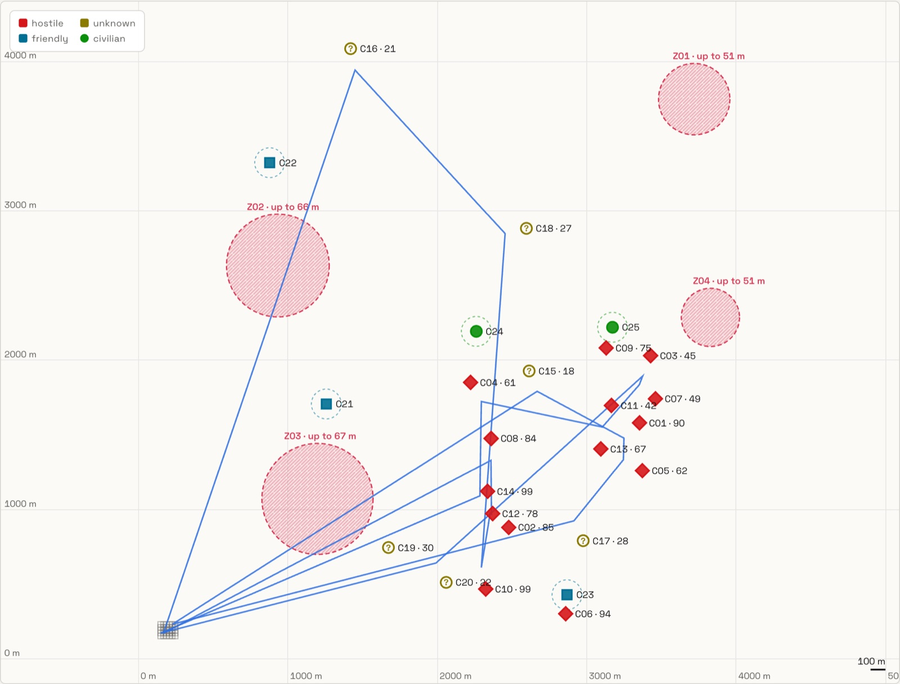

*Tournées des scouts après la première insertion regret-2. Les points d'observation sont reliés en ligne droite ; le vrai trajet contourne les zones.*

On insère d'abord le contact qui a le plus à perdre s'il attend :

`score = g1 + (g1 − g2)`

où g1 est le meilleur gain d'insertion du contact et g2 le deuxième meilleur.

> **Pourquoi :** le glouton prend le gain immédiat et bloque des contacts qui n'avaient qu'une seule bonne place.
>
> **Avantage :** on obtient un bon point de départ en une passe. Le même opérateur sert ensuite de repair dans l'ALNS.

### 05 · La boucle ALNS : casser, reconstruire

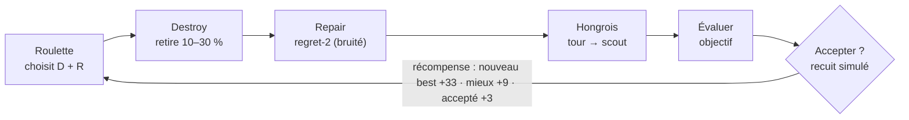

Il y a 5 destroy (aléatoire, pires, liés, route entière, secteur) et 3 repair (regret, regret bruité, glouton bruité). Leurs poids s'adaptent tous les 30 tours.

> **Pourquoi :** avec des fenêtres serrées, déplacer un seul contact échoue presque toujours. Retirer un bloc entier et le reconstruire débloque la situation.
>
> **Avantage :** on fait de grands sauts dans l'espace de recherche, et la roulette apprend seule quels opérateurs marchent sur *ce* scénario.

### 06 · Acceptation par recuit simulé

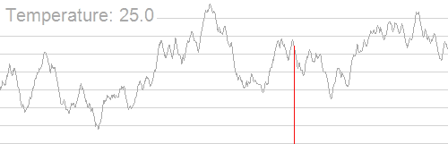

*Au début, le recuit accepte de descendre, puis il se stabilise sur le plus haut sommet.*

Une solution moins bonne est acceptée avec une probabilité `exp(Δ/T)`. La température `T` baisse jusqu'à 0 à la deadline.

> **Pourquoi :** n'accepter que les améliorations bloque vite dans un optimum local.
>
> **Avantage :** on explore au début et on intensifie à la fin. Le meilleur plan trouvé est toujours conservé.

### 07 · Algorithme hongrois pour les affectations

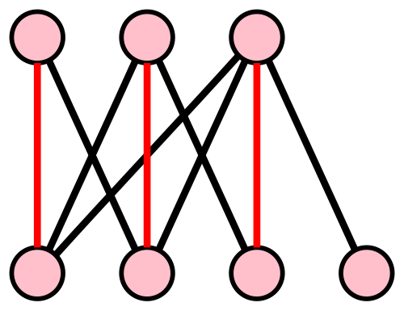

On l'utilise deux fois :

- pour réaffecter les tournées aux scouts, car chacun a sa base et sa batterie ;
- pour affecter les effecteurs aux hostiles à énergie minimale.

*Image : un couplage dans un graphe biparti. Chaque tâche reçoit au plus un agent.*

<br clear="right">

> **Pourquoi :** ce sont des problèmes d'affectation pure, pour lesquels il existe un algorithme exact.
>
> **Avantage :** l'affectation est optimale et garantie, en O(n³), soit moins d'une milliseconde à notre taille. Pas besoin d'heuristique.

### 08 · Réalisation 3D et validateur officiel

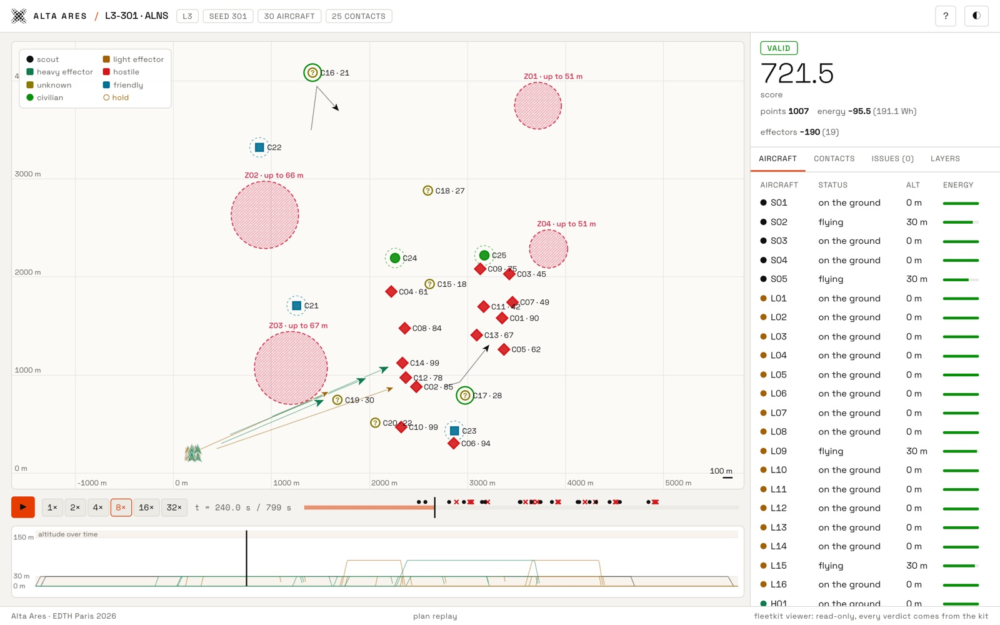

*Le plan final à t = 240 s : scouts en observation (cercles verts), effecteurs en route, frise des observations (●) et des engagements (✕). Le validateur répond VALID, 0 problème.*

Les 5 meilleures solutions (les élites) deviennent des waypoints datés en 3D : altitudes, séparation de 40 m, synchronisation des groupes. On les répare avec le validateur officiel et on garde le meilleur vrai score.

> **Pourquoi :** l'ALNS travaille sur un modèle 2D simplifié, qui ne classe pas toujours les solutions comme le vrai score.
>
> **Avantage :** on fait plusieurs essais au lieu d'un seul, et chaque plan rendu est vérifié par le même validateur que le board.

### 09 · Le résultat sur L3-301

| Glouton · 423,8 | ALNS · 721,5 |
|---|---|
| 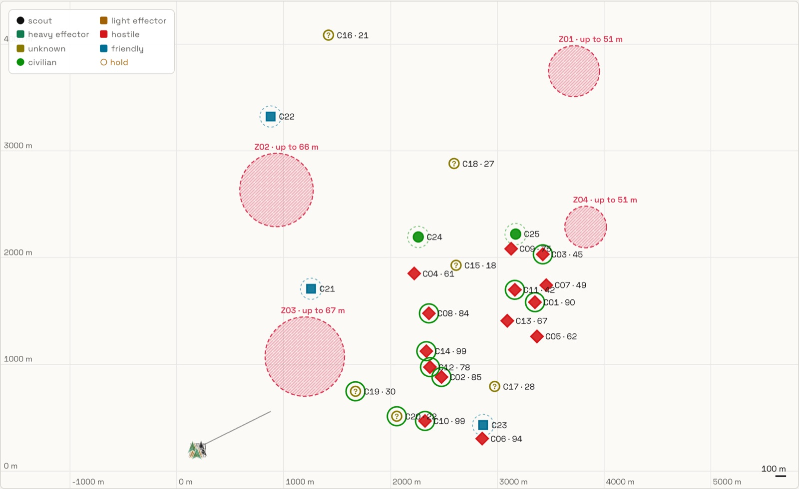 | 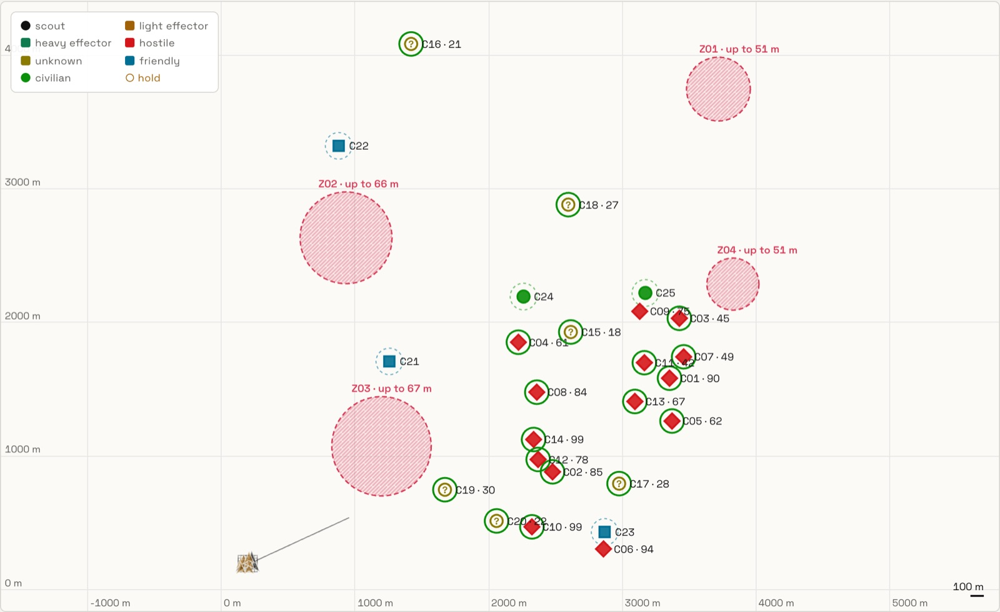 |
| 10 contacts servis, 15 effecteurs, 200 Wh. | 18 contacts servis, 19 effecteurs, 191 Wh. Seuls C06 et C09 manquent : R7 les interdit. |

Un cercle vert signifie que le contact est servi. Même scénario, même flotte : **+70 %, avec moins d'énergie.**

| Scénario | Glouton | ALNS | Gain |
|---|---:|---:|---:|
| L1-101 | 68,0 | 70,8 | +4 % |
| L2-201 | 277,8 | 294,9 | +6 % |
| L2-202 | 232,9 | 266,7 | +15 % |
| L3-301 | 423,8 | 721,5 | +70 % |
| L3-302 | 326,5 | 416,1 | +27 % |
| L3-303 | 275,9 | 444,9 | +61 % |
| L4-401 | 641,2 | 1 673,4 | ×2,6 |
| L4-402 | 418,5 | 1 186,5 | ×2,8 |
| **Total** | **2 664,5** | **5 074,7** | **×1,90** |

Run du 21/11/2026 : 8 plans valides, 43 s au maximum par scénario. Plus le scénario est gros, plus l'écart se creuse : c'est là que la recherche paie.

---

## Partie 2 : link loss, quand le sol se tait

### 10 · Le défi

À `t_loss`, la liaison sol est coupée pour toute la flotte. Chaque appareil appelle alors `Policy.step(obs)` une fois par seconde et choisit une action. Il ne peut pas inventer de route.

| Action | Effet |
|---|---|
| `continue` | suivre la route |
| `speed 0,5–1` | la suivre plus lentement |
| `hold` | faire du sur-place |
| `return` | remonter la route jusqu'à la base |

Trois événements surviennent sans être annoncés :

- un hostile **reclassé ami** ;
- une **zone interdite** qui apparaît ;
- un appareil en **panne**.

On ne les détecte qu'à moins de 300 m.

```
S_loss = rétention moyenne − 0,002 × messages par appareil par minute
```

La rétention tombe à 0 en cas de perte de séparation R8, d'entrée dans une zone, d'ami frappé, de violation R4 ou d'exception.

> **Ce qui compte :** une seule faute sur toute la flotte met le run à 0. La sécurité passe avant les points.
>
> **Et ensuite :** garder un maximum de la mission avec le moins de messages possible, parce que chaque message coûte.

### 11 · Navigation à l'estime : le plan sert de carte des autres

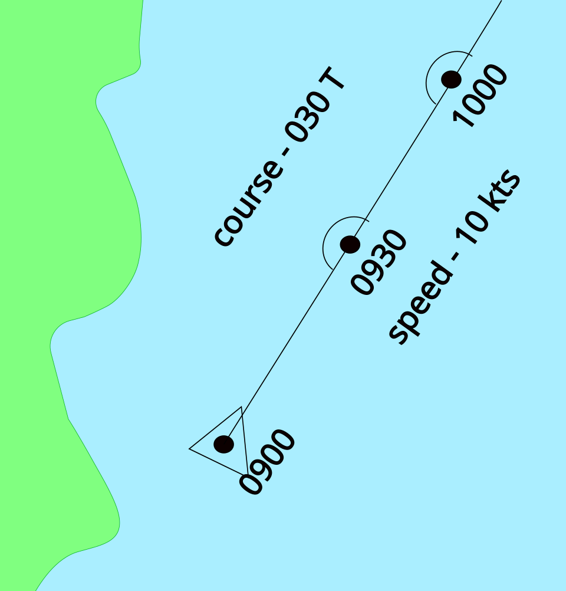

Chaque appareil embarque le plan complet. Un pair qui ne dit rien est supposé le suivre exactement : sa position se calcule sur son horloge de route (`RouteClock`). Seul celui qui **dévie** du plan parle.

*Image : avec un cap et une vitesse connus, on connaît la position sans la mesurer.*

<br clear="right">

> **Pourquoi :** la baseline `broadcast` diffuse sa position chaque seconde. Cela coûte 60 messages par minute et sature la radio.
>
> **Avantage :** on descend à 1,7 à 6,4 messages par appareil par minute, soit environ 0,01 point de pénalité au lieu de 0,12.

### 12 · Deux messages, envoyés sur événement

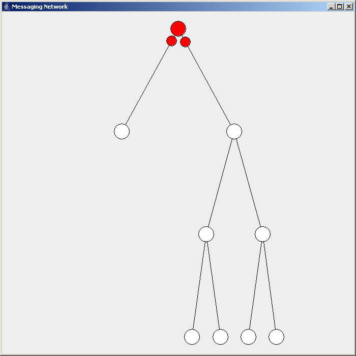

| Message | Sens |
|---|---|
| `{"k":[tau,rate]}` | « Je quitte le plan : mon horloge est à tau et avance à rate (1, 0,5, 0 ou −1). » |
| `{"o":["C12"]}` | « L'observation de C12 est finie. » Le scout l'envoie, chaque appareil la relaie une fois. |

*Image : propagation de proche en proche, chaque nœud relaie ce qu'il reçoit.*

<br clear="right">

- **Double envoi.** Chaque nouvelle info part 2 fois. Avec 5 % de perte, il reste 0,25 % de chance de tout perdre.
- **Rappel ciblé.** L'info n'est répétée que si un effecteur concerné est proche et va bientôt frapper.
- **Taille.** Un message fait toujours 64 octets au plus.

> **Pourquoi :** la capacité radio est partagée (50 à 800 o/s). Les messages inutiles font perdre les utiles.
>
> **Avantage :** la policy tient sur le réglage le plus serré. 50 o/s suffisent à toutes les portées (voir la frontière en §17).

### 13 · Porte R4 : pas de preuve, pas de frappe

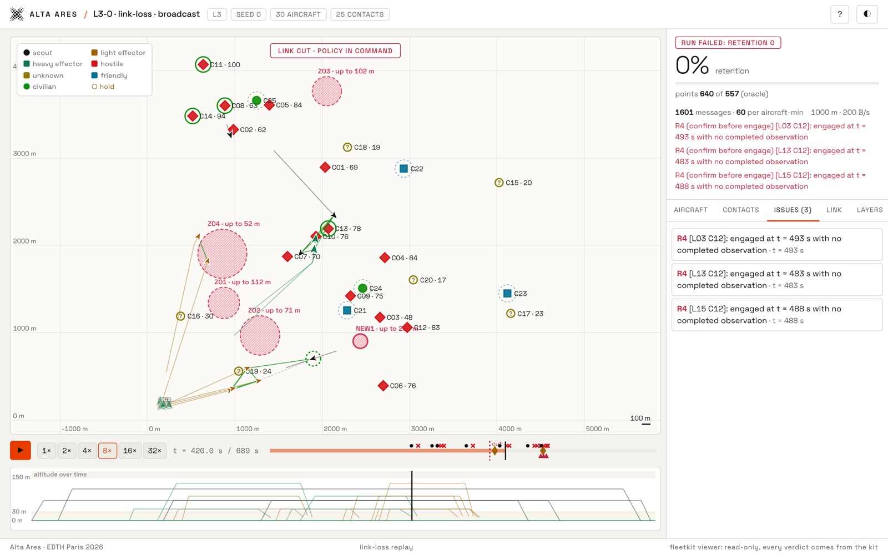

*La baseline `broadcast` sur L3-0. Le scout de C12 fait demi-tour à cause de la nouvelle zone, mais trois effecteurs frappent quand même C12. R4 est violée, et le run vaut 0 %.*

Un effecteur ne frappe que s'il sait qu'une observation de sa cible s'est terminée au moins 10 s avant (avec 0,5 s de marge en plus). Sinon, il s'arrête un pas avant la cible et attend la confirmation par message.

> **Pourquoi :** après la coupure, rien ne garantit que le scout a fini. Frapper à l'aveugle peut mettre tout le run à 0.
>
> **Avantage :** au pire, on perd une cible, jamais le run. Les observations finies avant la coupure sont déjà acquises : elles ne coûtent aucun message.

### 14 · Danger détecté : abandonner proprement

| Zone surprise · L3-0 | Cible reclassée · L2-1 |
|---|---|
| 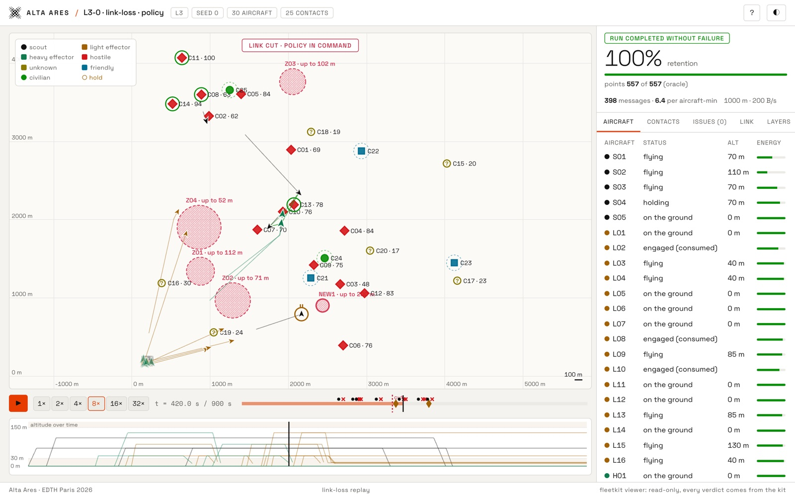 | 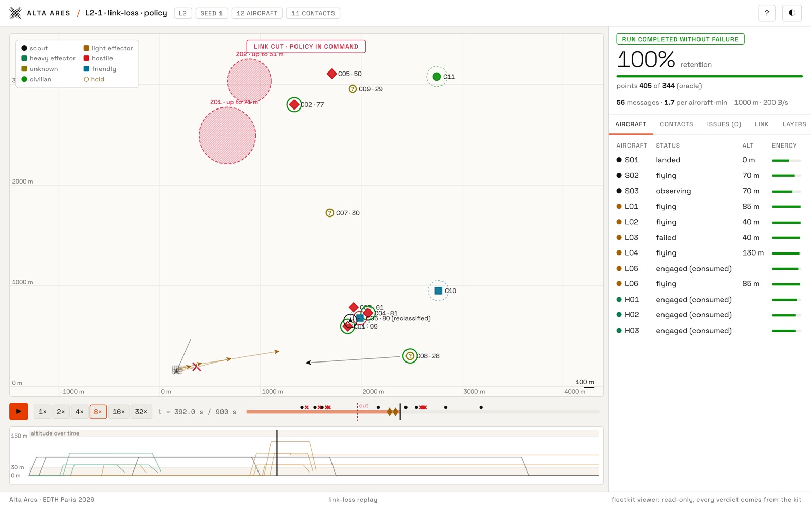 |
| Nouvelle zone NEW1 : S04 s'arrête puis fait demi-tour, et les effecteurs de C12 n'attaquent pas. 100 %, 0 violation. | C06 devient ami (carré bleu) et L03 tombe en panne. Personne ne frappe C06. 100 %, 0 violation. |

L'appareil passe en `return` dans trois cas : cible reclassée, zone sur la route, ou fenêtre déjà ratée. Un scout termine d'abord les observations encore possibles avant la zone, en gardant 8 s de marge.

Chaque appareil suit en pratique un petit automate à 3 états. Il est implicite dans `policy.py` : c'est le drapeau `aborted` plus `_intent()`, recalculé chaque seconde.

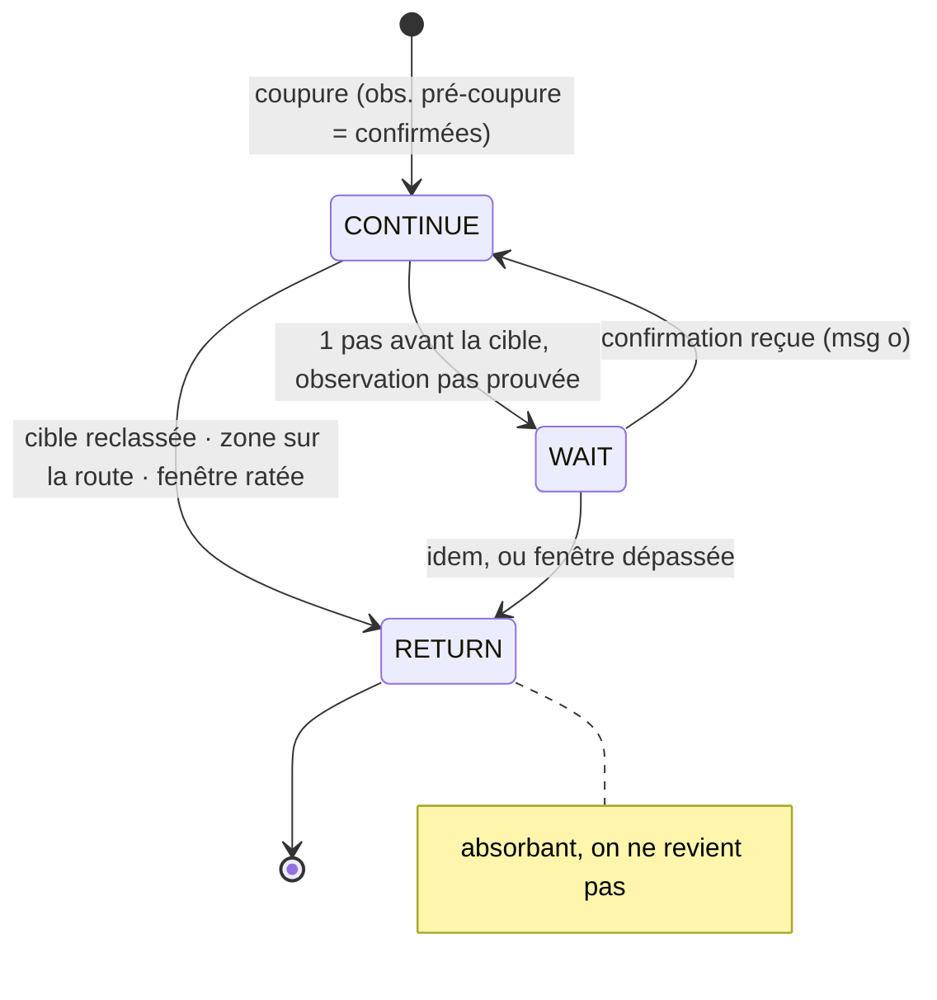

> **Pourquoi :** on ne peut pas contourner, seulement s'arrêter, ralentir ou reculer. Reculer sur sa route est toujours sûr.
>
> **Avantage :** zéro faute sur les événements, et le scout récupère quand même ce qu'il peut avant de partir.

### 15 · Le bouclier anticollision

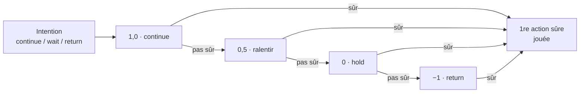

*Chaque action est testée par une simulation sur 4 à 6 s, par pas de 0,25 s. Elle est sûre si :*

- *la distance reste ≥ 40 m, plus 10 m de marge ;*
- *l'appareil reste à ≥ 25 m des zones ;*
- *ces deux conditions tiennent aussi si un pair s'arrête.*

Les actions sont testées dans l'ordre de préférence propre à l'intention. Pour chaque pair, on vérifie deux futurs : il fait ce qu'il a annoncé, ou il s'arrête. Si rien n'est sûr sur tout l'horizon, on prend l'action sûre sur les 2 prochaines secondes.

> **Pourquoi :** une seule perte de séparation suffit à faire échouer le run, et un pair dévié ne fera pas de place.
>
> **Avantage :** on reste sur le plan tant que c'est sûr, donc sans perdre de points, et on ne dévie qu'au dernier moment.

### 16 · Filet de sécurité et rapidité

`step()` est enveloppée dans un `try/except` qui renvoie `hold`. La bibliothèque standard suffit, et un appel dure 0,02 à 0,1 ms.

> **Pourquoi :** une exception fait échouer le run, et la cible matérielle est un Raspberry Pi 5 limité à 50 ms par appel.
>
> **Avantage :** un bug devient un sur-place au lieu d'un 0, et il reste 500 fois plus de marge que la limite.

### 17 · Le résultat

| Cas | Événements | Notre policy | Msg/min | broadcast | Msg/min |
|---|---|---:|---:|---:|---:|
| L2-0 | reclassé, panne | **0,996** | 1,8 | 0,880 | 60 |
| L2-1 | panne, reclassé | **0,997** | 1,7 | échec | 60 |
| L3-0 | zone, panne | **0,987** | 6,4 | échec | 60 |
| L3-1 | panne, reclassé | **0,997** | 1,7 | échec | 60 |
| L4-0 | reclassé, panne | **0,996** | 1,7 | échec | 60 |
| L4-1 | panne, reclassé | **0,996** | 2,2 | 0,380 | 60 |

Score S_loss par cas, mesuré avec `check_policy.py` sur 2 graines radio par cas, au réglage du board (1000 m · 200 o/s) :

- rétention de 100 % partout ;
- 0 run en échec ;
- `broadcast` échoue sur 5 des 6 cas.

| Portée \ capacité | 50 o/s | 100 | 200 | 400 | 800 |
|---|---|---|---|---|---|
| 250 m | 1,00 ✓ | 1,00 ✓ | 1,00 ✓ | 1,00 ✓ | 1,00 ✓ |
| 500 m | 1,00 ✓ | 1,00 ✓ | 1,00 ✓ | 1,00 ✓ | 1,00 ✓ |
| 1000 m | 1,00 ✓ | 1,00 ✓ | 1,00 ✓ | 1,00 ✓ | 1,00 ✓ |
| 2000 m | 1,00 ✓ | 1,00 ✓ | 1,00 ✓ | 1,00 ✓ | 1,00 ✓ |

Grille de sizing sur L3-0, le cas le plus dur (zone surprise) : 20 cases sur 20, sizing score de 1,00. La frontière est à 50 o/s pour toutes les portées, la plus basse possible.

---

<sub>Schémas de Wikimedia Commons :<br>
« Figure illustrating the vehicle routing problem » (PierreSelim, domaine public)<br>
« Hill Climbing with Simulated Annealing » (Kingpin13, CC0)<br>
« Bipartite graph with matching » (Illes, domaine public)<br>
« Dead-reckoning colour » (Belbury, CC0)<br>
« Flooding routing » (SuperFLoh, CC BY 2.5)</sub>

<sub>Captures : viewer fleetkit, scénario de validation L3-301 et replays link-loss L3-0 et L2-1 (scénarios générés, plans glouton, événements `make_events`).</sub>
